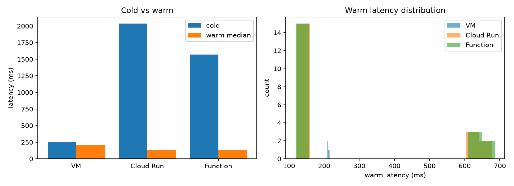

# Phase 1 — Comparison Report

Copy this file to `submission/phase1_report.md`, fill in every answer slot, and commit it:

```bash
cp phase-1-echo-bot/report_template.md submission/phase1_report.md
```

**How to fill it in.** Each answer sits between a pair of `<!--answer:...-->` markers. Replace
the `TODO` line with your answer — **leave the markers themselves untouched**, they are how the
grader finds your answers. Anything you write outside the markers is ignored, so add extra
prose, tables or images freely.

Numbers must **match `submission/phase1_report.json`** exactly — that file is produced by
`measure.py` and is what your figures are checked against. Copy them across; do not retype from
memory.

---

## 1. Setup facts

**Your image size**, in MB, from `gcloud artifacts docker images list` (number only, e.g. `142`):

<!--answer:image_size_mb-->
49.99
<!--/answer-->
For the Cloud Run Function the image size is 5.74 MB, but this is an understatement since it represents just the app and the installed libraries. The underlying OS, interpreter and execution environment reside in a Google-managed base image.

**The custom VPC and subnet you created** (names only):

<!--answer:vpc_name-->
echo-net
<!--/answer-->

<!--answer:subnet_name-->
echo-subnet
<!--/answer-->

---

## 2. Measurements

Copy these from `submission/phase1_report.json`. Cold is `cold_ms`; warm median is
`stats.median`. Numbers only, in milliseconds (e.g. `812.4`).

| Platform | Cold (ms) | Warm median (ms) |
|---|---|---|
| IaaS VM | <!--answer:vm_cold_ms-->249.5<!--/answer--> | <!--answer:vm_warm_median_ms-->210.8<!--/answer--> |
| Cloud Run | <!--answer:cloudrun_cold_ms-->2035.2<!--/answer--> | <!--answer:cloudrun_warm_median_ms-->130.4<!--/answer--> |
| Cloud Function | <!--answer:function_cold_ms-->1570.1<!--/answer--> | <!--answer:function_warm_median_ms-->129.6<!--/answer--> |

Include your histogram or plot of the warm distribution below (an image, or the ASCII chart
`measure.py` prints). This is read by a human, not the grader:

<!--answer:latency_plot-->


````Phase 1 — deployment measurements
------------------------------------------------------------
[OK  ] vm        cold=  249.5ms  warm_median=  210.8ms
            ########################################
[OK  ] cloudrun  cold= 2035.2ms  warm_median=  130.4ms
            #########################
[OK  ] function  cold= 1570.1ms  warm_median=  129.6ms
            #########################
------------------------------------------------------------
````
<!--/answer-->

---

## 3. Per-platform analysis

**Scaling behaviour.** Imagine requests arriving one at a time, then ten at once, then a
hundred. For each of the three platforms, answer concretely:

- Does anything get created automatically to absorb the load — and if so, *what* exactly?
  (One platform here creates nothing at all.)
- What is the hard limit, and where does it come from — a flag you passed yourself, or the
  size of the machine you picked?

(~80 words. Your `--machine-type=e2-micro` and `--max-instances=3` are both concrete answers
to the second question.)

<!--answer:scaling_behaviour-->
**VM:** Nothing is created; one container on one machine never scales. The limit is the hardware I chose: an e2-micro, shared-core with 2 vCPUs and 1 GB of memory.

**Cloud Run:** New container instances are created automatically as concurrent requests grow, and it scales to zero when idle. The limit is the `--max-instances=3` flag I set: at the default 80 requests per instance, that is about 240 concurrent requests.

**Cloud Function:** New instances are created automatically (it runs on Cloud Run underneath). I set no maximum, so the platform default applies, and each instance handles one request at a time.
<!--/answer-->

**Deployment effort.** What did you have to build, configure and maintain to get each of the
three running? (~100 words)

<!--answer:deployment_effort-->
**Shared:** I wrote the Dockerfile once and built and pushed one image with Cloud Build, after granting its service account an IAM role to fix a 403. The VM and Cloud Run both reuse that image.

**VM:** I built the network (custom VPC, subnet, two tagged firewall rules), created the VM, installed Docker, authenticated to Artifact Registry and ran the container. I had to maintain the OS, Docker and the billed external IP.

**Cloud Run:** One `gcloud run deploy`. No server, OS or network to maintain, but I still own the container image and must rebuild and redeploy it to update dependencies.

**Cloud Function:** No image: I deployed `main.py` and Cloud Build packaged it. Google maintains the runtime; I only maintain my code and redeploy when it changes.
<!--/answer-->

---

## 4. Why do two of your three numbers look alike?

With Cloud Run and your Function both deployed, run `gcloud run services list` and paste the
**complete output** here, unedited:

<!--answer:run_services_list-->
✔
SERVICE: echo
REGION: us-central1
URL: https://echo-229965748812.us-central1.run.app
LAST DEPLOYED BY: service-229965748812@gcf-admin-robot.iam.gserviceaccount.com
LAST DEPLOYED AT: 2026-10-19T13:52:52.786539Z

✔
SERVICE: echo-bot
REGION: us-central1
URL: https://echo-bot-229965748812.us-central1.run.app
LAST DEPLOYED BY: jacopo.piergiovanni@eurecom.fr
LAST DEPLOYED AT: 2026-10-19T13:37:31.647922Z
<!--/answer-->

Now explain what that output tells you about how your Function is actually being run, why its
cold start resembles Cloud Run's so closely, and what — if anything — genuinely differs between
the two deployment paths. (~120 words)

<!--answer:convergence_explanation-->
The list shows that my Function `echo` is itself a Cloud Run service, listed next to `echo-bot`. It was deployed by the Cloud Functions service agent, which created the service on my behalf from my source code, while I deployed `echo-bot` myself. The cold starts resemble each other (1570 ms vs 2035 ms) because both are containers started on demand by the same Cloud Run infrastructure, and a single cold sample is noisy. What genuinely differs is the input and the defaults. For `echo-bot` I supplied a finished image, built from my own Dockerfile, and chose its limits (`--max-instances=3`). For the Function I supplied only source: Cloud Build packaged it with Google's Python 3.11 runtime, and the platform set the defaults (concurrency 1, 256M of memory).
<!--/answer-->
