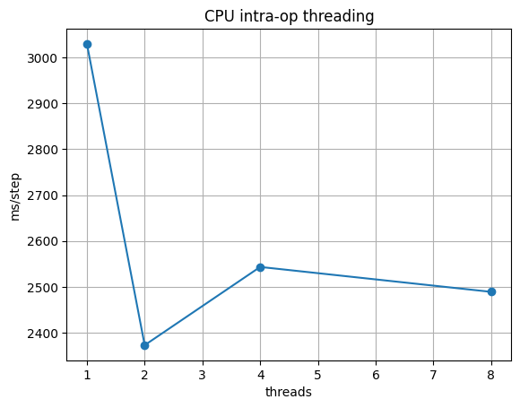

# Phase 2 — Reflection: where does parallelism stop helping?

Copy this file to `submission/phase2_reflection.md`, fill in every answer slot, and commit it:

```bash
cp phase-2-tiny-gpt/reflection_template.md submission/phase2_reflection.md
```

**How to fill it in.** Each answer sits between a pair of `<!--answer:...-->` markers. Replace
the `TODO` line with your answer — **leave the markers themselves untouched**, they are how the
grader finds your answers. Anything you write outside the markers is ignored, so add extra
prose, tables or your threading plot freely.

Numbers in section 1 must **match `submission/phase2_report.json`** — copy them across, do not
retype from memory; they are checked against it.

---

## 1. Your measurements

| | Value |
|---|---|
| Naive attention, ms (`attention.naive_ms`) | <!--answer:attn_naive_ms-->277.666<!--/answer--> |
| Vectorized attention, ms (`attention.vectorized_ms`) | <!--answer:attn_vectorized_ms-->1.238<!--/answer--> |
| CPU training, ms for 100 steps (`devices.cpu_ms`) | <!--answer:cpu_ms-->497744.3<!--/answer--> |
| GPU training, ms for 100 steps (`devices.gpu_ms`) | <!--answer:gpu_ms-->13428.2<!--/answer--> |
| Final training loss (`training.final_loss`) | <!--answer:final_loss-->1.4349<!--/answer--> |

**The thread sweep.** Give your four timings from `threads` — 1, 2, 4 and 8 threads — and say
which count was fastest. (verbatim: the numbers, in order)

<!--answer:thread_sweep-->
1 thread: 3029.396 ms, 2 threads: 2373.176 ms, 4 threads: 2543.541 ms, 8 threads: 2489.27 ms. The fastest was 2 threads.
<!--/answer-->


---

## 2. Intra-node parallelism, three ways

**Why vectorizing wins.** Both attention implementations do the same arithmetic and produce the
same result (the unit test checks that). Explain where the naive version's time actually goes,
and what the vectorized one does differently — in terms of the machine, not the Python.
(~70 words)

<!--answer:vectorization_why-->
The naive version loops over every (i, j) pair in Python, so it makes 2 × 256 × 256 tiny NumPy calls, each on just 64 doubles. Most of the time goes into interpreter and dispatch overhead per call: instruction fetch/decode, type checks, temporary arrays. Each call is too short for SIMD to pay off. The vectorized version makes two large matrix multiplications through OpenBLAS. It VLOADs contiguous rows into wide AVX2 registers (4 doubles each), applies one FMA to all of them, and blocks the work so data stays in cache. That’s why it went from 277.666 ms to 1.238 ms.
<!--/answer-->

**Where the thread curve flattens, and why.** Using your sweep: more threads stopped helping —
or started hurting — at some point. Say where, and give the reason. Your Colab runtime's vCPU
count is part of the answer; so is what the threads have to coordinate on. (~80 words)

<!--answer:threading_plateau-->
The curve flattens at 2 threads. 1 to 2 threads went from 3029.396 to 2373.176 ms, only 1.28x. 4 threads (2543.541 ms) and 8 threads (2489.27 ms) were slower. The Colab runtime has 2 vCPUs, which are probably two hyperthreads of one physical core, so even 2 threads don’t double the compute. Past 2 there are more threads than hardware contexts, so the OS time-slices them. Threads share one address space and have to synchronize on shared tensors at every operation. Cache lines move back and forth between cores (contention), and that costs more than the extra threads gain.
<!--/answer-->

**What made the GPU faster.** The model, the data and the step count were identical; only the
device changed. Say what about a transformer training step suits a GPU, and name one workload
that would *not* see this speed-up. (~70 words)

<!--answer:gpu_why-->
A training step is mostly dense matrix multiplies, and every output element is identical, independent work. That is the SPMD pattern GPUs are built for. With SIMT, thousands of threads run the same instruction in lockstep on different data, so one fetch/decode serves many threads, and GPU memory is designed for bandwidth. 497744.3 ms became 13428.2 ms (37.1x). A workload that would not see this speed-up is a sequential recurrence such as x[i] = f(x[i-1]). Each step depends on the previous one, so there is no independent data for SIMT threads to share, and a single GPU thread is slower than a CPU core.
<!--/answer-->

---

## 3. The question

**Where does parallelism stop helping, and why?** Pull the three experiments together. Your
answer should distinguish the *kinds* of limit you met — work that cannot be divided, hardware
you do not have, coordination that costs more than it saves, data that has to move — and say
which one bound each experiment. One concrete number from section 1 per claim. (~150 words)

<!--answer:parallelism_limit-->
Each experiment hit a different kind of limit. Vectorization runs into work that can’t be divided: SIMD only speeds up independent elements in the innermost loop, up to the vector length (4 doubles with AVX2). The naive code was dominated by per-call overhead on 64-element pieces, and handing the whole problem to BLAS as two large matrix multiplications removed that overhead, giving 224x (277.666 to 1.238 ms). Threading first ran into hardware I don’t have. With 2 vCPUs, the best result was 2 threads at 2373.176 ms. After that the limit was coordination. 4 threads (2543.541 ms) were slower than 2 because threads in a shared address space contend on synchronization and cache coherence, the same effect as the lecture’s OpenMP integral running slower than one CPU. The GPU was limited by data that has to move. 37.1x (13428.2 ms) is far below the T4’s raw compute advantage, because every batch is copied host-to-device and a 4.9M-parameter model’s small kernels don’t do enough arithmetic per byte moved. Systolic arrays and TPUs are designed to fix exactly this.
<!--/answer-->

**What you would measure next.** One experiment this phase did not run that would sharpen the
answer, and what result would change your mind. (~50 words)

<!--answer:next_experiment-->
For the next measurement, I would rerun the thread sweep on a Compute Engine VM with 8 physical cores, testing 1 to 16 threads. If the fastest count tracks the core count, the Colab plateau was a hardware limit. If it still stops at 2–4 threads, the limit is coordination and serial work inside each step. Then probably only bigger batches, more work per synchronization, would let extra threads pay off.
<!--/answer-->
